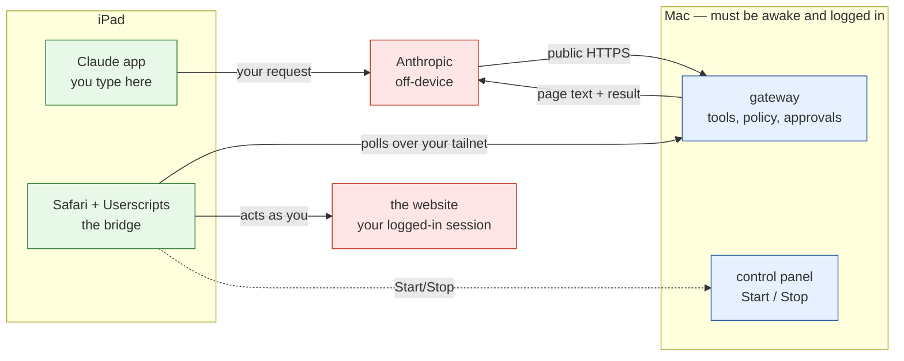

# Safari AI Agent

**Integration candidate — Claude/iPad workflow proven; final reliability and security acceptance remain open.**

**2026-10-13:** [Gateway controls](docs/GATEWAY-CONTROLS.md) add Mac/iPad Start/Stop, automatic startup and website permissions through a UI. Reading is available across websites; site entries grant action permissions. The remote script build is **0.2.5**. These new controls passed local engineering checks and Mac Safari UI verification; updated iPad acceptance is still pending. Double-click **Safari Gateway.command** to set them up. [ChatGPT/Gemini feasibility research](docs/PROVIDER-IPAD-RESEARCH.md) is recorded for an owner-approved next plan.

An iPad-first browser automation project under SearchingFool. A user asks a supported AI assistant to inspect, search, navigate, fill and interact with ordinary webpages in Safari; an independently constrained Userscripts bridge executes the approved actions. No iPad-local LLM or Apple Developer membership is required for the Userscripts prototype.

## Risks you must understand before you start

This software lets an AI assistant click and type inside a browser where **you are already logged in**. Read this section in full. It is not boilerplate.

### 1. Web pages you inspect are sent to the AI provider

When the agent looks at a page, that page's visible text goes to the AI company's servers. If you are signed in, that can include your name, your email address, your feed, your messages, your documents. Input values and password fields are deliberately excluded, but **everything else you can see, it can see**.

**Only use this on pages you would be comfortable pasting into a chat window.**

### 2. The agent acts as you, and the website cannot tell

It uses your existing browser session — your cookies, your login. The website has no idea an agent is involved; it sees you. There is no server-side permission check anywhere, and the site's audit log will record your name, not the agent's.

This differs fundamentally from a normal integration, where a service checks a token it issued and can refuse. **Your website permissions and approvals authorize the agent to act in your session.** Full permission executes recognised navigation and page interactions without an individual prompt; submissions, data changes and unclear controls still ask. Classification cannot prove what a website's JavaScript will do.

### 3. Web pages can try to hijack the agent

A malicious page can embed instructions aimed at the AI rather than at you — "prompt injection". The agent reads the page, and the page tries to give it orders.

Reading across websites broadens the content that can enter the AI conversation. A read-only page can contain instructions that influence a later action on a trusted website in the same conversation. Per-site action permissions and local approval remain enforced, but they do not remove those instructions from the model's context.

This is the single biggest unsolved risk for every AI browser agent, including well-funded commercial ones. In March 2026 a zero-click vulnerability was found in Anthropic's own Chrome extension that let a visited page take control. It was patched — but **assume this project has undiscovered holes too.** It has had no security review.

### 4. Approval fatigue is a real failure mode

Ask mode prompts before each action. Full permission avoids prompts for recognised navigation and page interactions. The remaining prompts name the target and action category. **Read them before approving.** “Always allow this button on this page” saves a control-specific approval in isolated Userscripts storage; revoke saved approvals in Remote AI. Stop cancels execution and disconnects; it does not erase those saved preferences.

### 5. Some actions cannot be undone

Sending, posting, publishing, purchasing, deleting. Certain controls are refused outright and are never offered for approval. But that protection is a work in progress: it is known to be **too strict in places** (it blocks some harmless navigation) and **not strict enough in others** (Like, Follow and Subscribe currently pass through to an ordinary prompt). See `docs/DECISIONS.md` D-019.

### 6. Running the Mac gateway exposes a public web address

The Tailscale Funnel setup makes your Mac reachable from the internet. Both entrances require passwords, and the demo pages are inert — but it is public while it runs. **Stop it when you finish.**

### 7. Known gaps, stated plainly

| | |
|---|---|
| **D-017** | Two connected tabs deadlock with no way out from the interface |
| **D-019** | The blocked-actions list is a keyword match; it misses non-English labels and icon-only buttons |
| **D-023** | A permission prompt can appear in a tab you are not looking at |
| **D-014** | Depends on Userscripts, an App Store-only app with effectively one maintainer |
| — | No security review. No injection defences. Not audited by anyone |

### 8. What this is for

A **prototype for supervised use on pages you trust**, by the person who set it up. It is not a product, not multi-user, and not suitable for anything sensitive, financial or irreversible. Use the bundled `/demo` pages until you understand how it behaves.

## How it fits together

Three pieces. **Everything runs on your Mac and your iPad except the model itself.**



**Full detail, with every hop and what authenticates it:**
[Architecture and data flow](docs/ARCHITECTURE-DATAFLOW.md).

## Installing it — start here if you are new

**You need:** a **Mac** (macOS 12+, awake and online) · an **iPad** (iPadOS 15.1+) ·
**[Tailscale](https://tailscale.com)** installed and signed into the **same account on both** ·
a **Claude account** that supports custom connectors · **Node.js 20+** on the Mac ·
about **30 minutes**.

**Read the risks above first**, then follow **[the setup guide](docs/SETUP-GUIDE.md)** — it is
written step by step for non-technical users and names which device each step happens on. It
starts by cloning this repo; you do not need anything from here first.

Roughly: **Mac** (get the code, start the gateway) → **Claude** (add a connector) →
**iPad** (install the bridge, pair it).

Once it is running, the gateway serves its own instructions at **`/help`** — open that on the
iPad and follow along there. No password, and it contains no credentials.

### Two ways to start it, once installed


**Read the risks above first.** Then follow **[the setup guide](docs/SETUP-GUIDE.md)**, which is
written step by step for non-technical users and covers the Mac, Claude and the iPad in order.

| | Route A — control panel *(easier)* | Route B — Terminal |
|---|---|---|
| **Start it** | Double-click **`Safari Gateway.command`** | `bash tools/start-mac-tailscale-test.sh` |
| **Then** | Start/Stop from a web page, including from the iPad | Leave the Terminal window open; closing it stops everything |
| **Good for** | Everyday use | Debugging, or watching the log live |
| **Details** | [Gateway controls](docs/GATEWAY-CONTROLS.md) | [Setup guide](docs/SETUP-GUIDE.md) Part 1 |

**Once the gateway is running it serves its own instructions at `/help`** — open that address on
the iPad and follow along there. No password, and it contains no credentials.

### Updating it later

Nothing updates itself, and the parts are separate — **[setup guide Part 5](docs/SETUP-GUIDE.md)**
covers the code on the Mac, the script on the iPad, and the passwords. A running gateway keeps
using the code it started with, so an update does nothing until you restart it.

### Stuck?

```sh
npm run gateway:status
```

Checks every layer and tells you what to press. In Claude Code or the Claude desktop app,
**`/safari-agent-gateway`** knows the whole lifecycle — install, start, update, rotate — and can
read the gateway log, which tells a wrong password apart from an unreachable server. The error
messages on screen cannot.

## Where to start

- **[Setup guide](docs/SETUP-GUIDE.md) — step-by-step instructions, written for non-technical users. Start here if you just want to use it.**
- **[Device lifecycle](docs/DEVICE-LIFECYCLE.md) — adding an iPad, and removing everything from one before you pass it on, sell it or return it.** The device token is a standing grant to drive a browser and **signing out of iCloud does not remove it**. Read this before pairing a device you will not keep.
- [Product requirements](docs/PRODUCT_REQUIREMENTS.md) — definitive product MVP acceptance criteria.
- [Implementation plan](docs/IMPLEMENTATION_PLAN.md) — phases B1–D, dependencies and release gates.
- [Decision log](docs/DECISIONS.md) — architecture and decisions still requiring real evidence.
- [MCP setup and deployment](docs/MCP_INTEGRATION.md) — exact setup procedure.
- [Release checklist](docs/RELEASE_CHECKLIST.md) — what remains before user acceptance.
- [Execution evidence](docs/B1_D_STATUS.md) and [work tracker](docs/TRACKER.md).

## Existing components

| Component | Function | State |
|---|---|---|
| `scripts/safari-ai-agent.user.js` | Manual **Browser Lab**; no remote AI connection | v0.1.1; previous iPad form testing |
| `scripts/safari-ai-agent-remote.user.js` | Separately installed, opt-in remote Userscripts bridge | **v0.2.5**; tested with mocked Userscripts APIs in Chromium |
| `gateway/server.mjs` | Authenticated MCP Streamable HTTP gateway, per-device action queue and authorization | Local HTTP tests passed; not deployed |
| `/demo` and `/demo/product` | Harmless two-page test site served by gateway itself | Tested through gateway; actual Safari flow pending |
| `Dockerfile` | Node 22 container gateway, non-root runtime | Created; image build needs Docker-equipped environment |

The gateway exposes seven browser tools: `browser_status`, `browser_inspect`, `browser_fill`, `browser_click`, `browser_navigate`, `browser_verify`, `browser_cancel`. The iPad bridge uses the GM extension APIs in an isolated content-script context; no model credentials or arbitrary model-generated JavaScript reach the webpage. Reading is permitted across websites. Managed controls and the CLI default to asking in Safari before every fill, click and same-site navigation, with no standing approvals. Explicit website entries can restrict actions to reading, allow ordinary fills and navigation without clicks, or automatically execute recognised navigation and page interactions. Generic form submissions always require their own approval. Payment, account-deletion and credential/security controls remain refused. Remote script 0.2.5 is required for category-based full permission and persistent button approvals; older scripts retain their previous approval behavior until updated.

## Run automated checks

Requirements: Node.js 22+, Python 3.12+, Playwright and Chromium for browser tests. No Node package dependencies.

```sh
npm run check
npm run test:browser
```

GitHub Actions separately runs Node tests and Chromium browser tests, including a full two-page workflow test in an unrestricted CI browser environment. The local gateway-to-DOM test sends actual MCP HTTP requests through the server but mocks Userscripts' privileged GM transport and loads an in-memory fixture because network navigation is restricted in this environment.

## Try after a public HTTPS deployment

1. Configure `MCP_CLIENT_TOKEN`, `DEVICE_TOKEN` (different random secrets), and `SAFARI_ALLOWED_ORIGINS=https://YOUR_HOST` on the deployed gateway, and terminate TLS at the hosting ingress. **Do not post tokens in chat, logs or GitHub.**
2. Verify the public endpoint using `MCP_ENDPOINT=https://YOUR_HOST/mcp npm run check:deployment` with the MCP caller token in a local environment variable.
3. Install the [remote userscript](scripts/safari-ai-agent-remote.user.js) in Userscripts, visit `https://YOUR_HOST/demo`, enter gateway base URL and **device** token, Save and Connect.
4. Add `https://YOUR_HOST/mcp` as a Claude **custom remote MCP connector** and configure a fixed `Authorization: Bearer ...` header holding the distinct **MCP caller** token. These steps require the user's own eligible Claude account.
5. Ask Claude to search for *widget*, open the demo result, fill a fictional name and `14:30`, press *Preview selection*, verify *Preview ready*, and stop without submitting.

See [MCP setup](docs/MCP_INTEGRATION.md) and [release checklist](docs/RELEASE_CHECKLIST.md) for full safeguards and limitations. The same installation is **not** proof that Claude, ChatGPT or Gemini subscription access is active for any specific account.

## Security and scope

Use only on harmless demonstration pages until iPad acceptance and an independent security review. Browser text may contain confidential data and is sent to the connected model when inspected. The optional remote script can be stopped manually; Stop now revokes queued commands at the gateway where reachable. The full configurable governance harness remains a later milestone. **The remote integration is not a general-purpose trusted autonomous browser or an enterprise authorization system.**

## Public demo security

The Mac Tailscale test launcher now generates a **third, independent demo password**. The browser challenges for username `safari-demo` and the local `DEMO_PASSWORD` from `.env.mac-tailscale`; unauthenticated requests receive no demo HTML. The MCP and device credentials remain distinct and are never used as browser passwords. This is basic protection for a test site, not complete production hardening. The HTTPS endpoint remains publicly reachable while Funnel runs. If the Mac launcher was already running, stop it before updating code and relaunching.

## Mac + Tailscale live MCP testing

To test the hosted gateway without Verpex, use the [Mac Tailscale Funnel guide](docs/MAC_TAILSCALE_TEST.md) and the launcher `bash tools/start-mac-tailscale-test.sh`. The Mac hosts Node on localhost; Funnel provides the public HTTPS URL needed by Claude's remote MCP connector. Keep credentials on the Mac and use only the harmless demo for initial testing. **Account and iPad acceptance remain unverified.**
