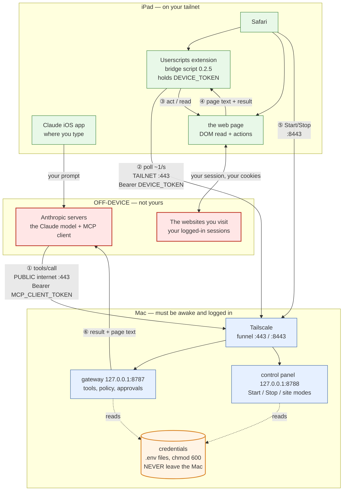
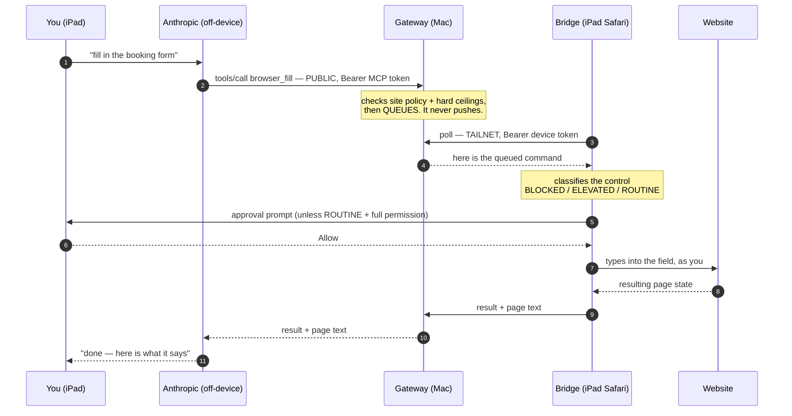

# Architecture and data flow — what talks to what

**File:** `docs/ARCHITECTURE-DATAFLOW.md` (repo-relative — this repo is public)
**Description:** Where every component runs, which network each hop crosses, what authenticates it, and exactly what data leaves your devices. Drawn from observed gateway traffic on 2026-10-24, not from design intent.
**Author:** Libor Ballaty <liborballaty@gmail.com>, with Claude Opus 5 (safari-ai-agent-04, D-047)
**Created:** 2026-10-24
**Last Updated:** 2026-10-24
**Last Updated By:** Libor Ballaty <liborballaty@gmail.com>, with Claude Opus 5 (safari-ai-agent-04)

---

## 1. Evidence this is accurate

Every hop below was **observed in `logs/gateway-diagnostics.jsonl`**, not inferred:

| Path | Source seen | Network |
|---|---|---|
| `/mcp` | a public address, user-agent `Claude-User` | **public internet** (Anthropic) |
| `/device/poll`, `/device/result` | a tailnet address | **tailnet** (the iPad) |
| `/demo` | a tailnet address | tailnet (the iPad) |
| `/health` | the Mac itself, and a public address | loopback and public |

**This corrects `docs/DEVICE-LIFECYCLE.md`**, which states the iPad is not a tailnet member and
reaches the gateway over the public internet. It **is** a member, and its traffic arrives over the
tailnet (a `100.x` CGNAT address) rather than from a public one.

## 2. Where everything runs

## 3. One action, end to end

**The gateway never initiates.** It holds work until the iPad asks. Nothing can be pushed to your
browser, and a tab that stops polling simply stops receiving work.

## 4. Which network each hop crosses

| # | Hop | Network | Authentication | Encrypted by |
|---|---|---|---|---|
| ① | Anthropic → gateway | **PUBLIC internet** | `Bearer MCP_CLIENT_TOKEN` | TLS (real cert, Funnel) |
| ② | iPad bridge → gateway | **tailnet** | `Bearer DEVICE_TOKEN` | WireGuard + TLS |
| ③④ | bridge ↔ page | **inside the iPad** | none needed | n/a |
| ⑤ | iPad → control panel | **public `:8443` today** | Basic `safari-control` | TLS |
| ⑥ | gateway → Anthropic | reply on ① | — | TLS |
| — | page ↔ website | iPad → internet | **your own login** | the site's TLS |
| — | Funnel → gateway/panel | **loopback only** | — | never leaves the Mac |

**Only ① genuinely needs to be public** — Anthropic's servers cannot reach your tailnet.
**⑤ does not:** the iPad is on the tailnet, so `:8443` could be `tailscale serve` (tailnet-only)
instead of `funnel` (public). That would remove a password-protected endpoint, reachable by
anyone on the internet, that can start and stop your gateway.

## 5. What actually leaves your devices

**This is the part worth reading twice.**

| Data | Goes to | Notes |
|---|---|---|
| **The text of pages you inspect** | **Anthropic** | Name, email, feed, messages — whatever is on screen. Input *values* are excluded; nothing else is. |
| Your prompts and the agent's replies | Anthropic | ordinary chat |
| Which site, which control, the outcome | Anthropic | in tool results |
| **Credentials** | **nowhere** | The four secrets live in `.env` files on the Mac at `chmod 600`. No code path sends them anywhere. |
| Your website logins | the website only | the agent uses the session already in Safari |

**The website cannot tell an agent is involved.** It sees your cookies, your session, your name in
its audit log. There is no server-side permission check anywhere in this design — the only thing
between the model and your account is the approval prompt.

**Consequence (D-041):** because page text enters the model's context, a malicious page you merely
*read* can try to influence what the agent does next on a site where it *is* allowed to act. Reading
is the injection vector, so a read-only site is not a harmless site.

## 6. Trust boundaries, in order of exposure

1. **Off-device, not yours** — Anthropic and the websites. Receives page content. Cannot start anything.
2. **Public internet** — the gateway `:443`, and today the control panel `:8443`. Anyone can reach
   these; only a correct token gets past them.
3. **Tailnet** — your four devices. Authenticated at device level by WireGuard.
4. **The Mac's loopback** — where the gateway and panel actually listen. **The Funnel is the only
   door in**; stop it and nothing is exposed.
5. **The `.env` files** — the innermost ring. Nothing reads them but the two local processes.

## 7. What breaks what

| If this stops | Consequence |
|---|---|
| Mac sleeps / shuts down / logs out | **Everything stops.** Nothing can be restarted remotely. |
| Tailscale stops on the Mac | Both endpoints vanish; Claude and the iPad both fail |
| Gateway stops | Claude gets errors; the control panel still answers, so you can Start it from the iPad |
| **Control panel stops** | **No remote recovery** — the gateway can only be started at the Mac |
| iPad tab backgrounded | Agent pauses by design (D-029). Split View is mandatory |
| Credentials rotated | Every stored copy dies at once: connector, iPad, panel |

**The single point of failure is the Mac being awake and logged in.** The control panel narrows
the gap — it can start the *gateway* remotely — but nothing starts the *panel* remotely.

## 8. The four credentials

| Name | Guards | Used by | Lives in |
|---|---|---|---|
| `MCP_CLIENT_TOKEN` | the AI's way in | Anthropic | `.env.mac-tailscale` |
| `DEVICE_TOKEN` | the browser bridge | iPad Userscripts storage | `.env.mac-tailscale` |
| `DEMO_PASSWORD` | demo pages + script install | your browser | `.env.mac-tailscale` |
| `CONTROL_PASSWORD` | Start/Stop panel | your browser | `.env.gateway-control` |

Deliberately **four separate secrets**. A gateway page that revealed the device token was rejected
for exactly this reason: the demo password would then yield it, collapsing two secrets into one.
