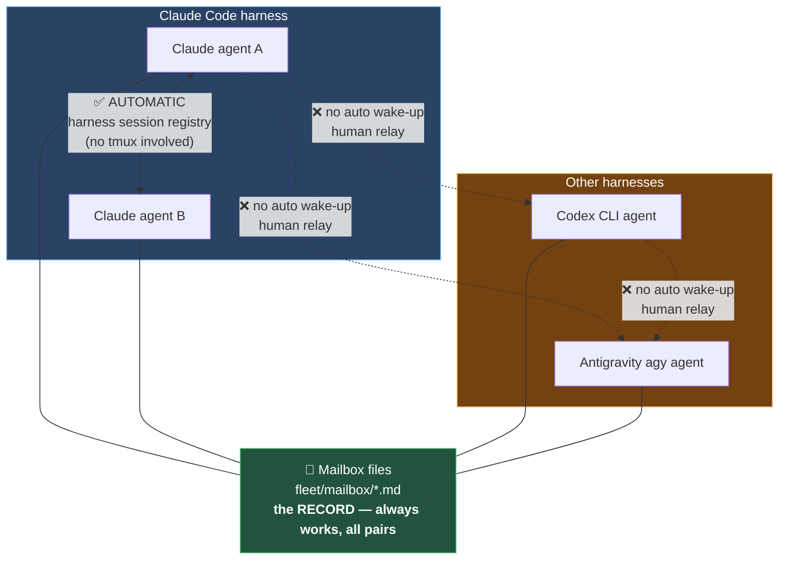
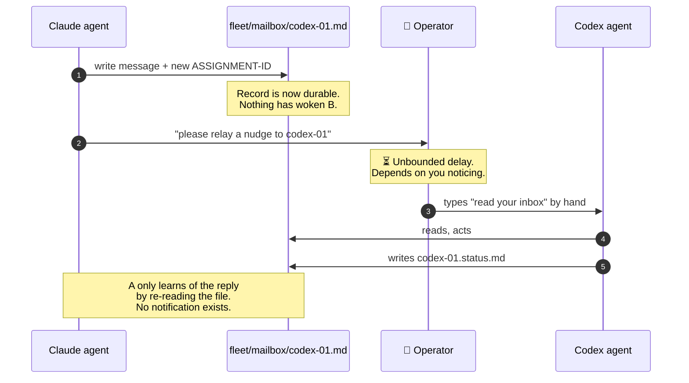
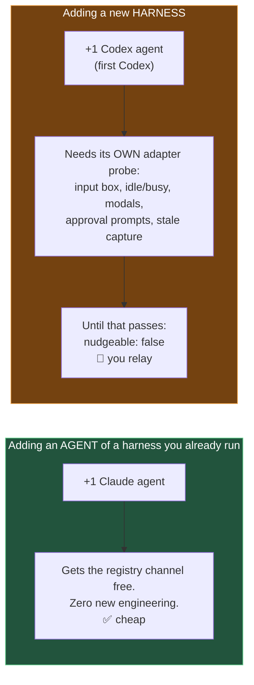
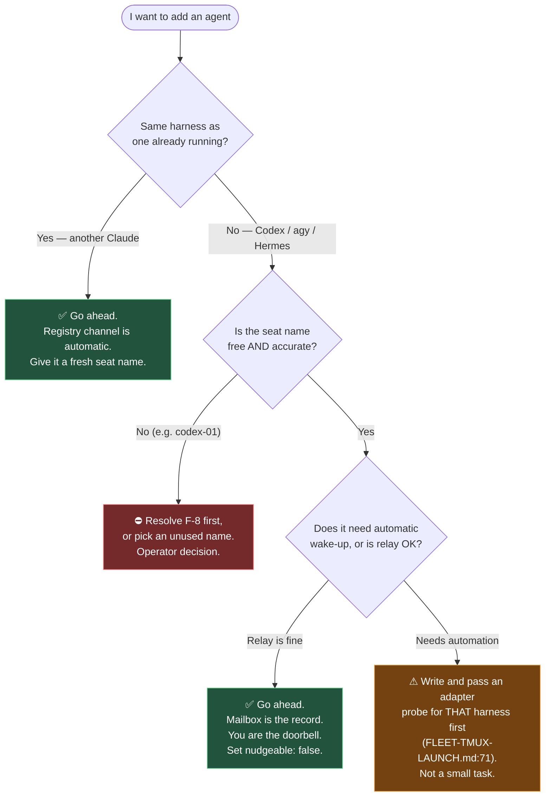

# Cross-Harness Agent Communication — What Works, What Doesn't, and What Adding an Agent Costs

**File:** `docs/FLEET-CROSS-HARNESS-COMMUNICATION.md`
**Description:** Which agents in this fleet can actually talk to which, by what mechanism, and what changes when a Codex or Antigravity agent is added alongside the Claude ones. Written to answer a planning question that recurs every time the fleet grows. Companion to `docs/FLEET-TMUX-OBSERVABILITY-ANALYSIS.md`, which covers the tmux hosting and observability side.
**Author:** Libor Ballaty <liborballaty@gmail.com>, with Claude Opus 5 (seat `safari-ai-agent-codex-01` — note that this seat's name is itself a known misnomer, see §7.1)
**Created:** 2026-10-25
**Last Updated:** 2026-10-25
**Last Updated By:** `safari-ai-agent-codex-01`

> **This repository is public.** Per `fleet/README.md` this document omits process IDs, tty
> names, usernames, endpoints and absolute paths containing the operator's home directory.

---

> # ⚠ CORRECTION — 2026-10-25, READ THIS FIRST
>
> **The first draft of this document was wrong on its central claim, and the error came from
> trusting documentation instead of reading the code.** It asserted that cross-harness agents
> have no automatic wake-up and need a human relay. **They do have one, it is harness-agnostic,
> and it was working.**
>
> The mechanism is **`~/.ai-dev-dotfiles/tools/fleet-inbox-wait.sh`** — the agent waits on its
> **own** inbox rather than being pushed to. Its header states the design in its own words:
>
> > *"IS: a content-hash watch on one file, with a bounded timeout and clean exits.
> > **COST: wall-clock, not tokens. The sleeping happens in the shell, not the model.**"*
>
> That single design choice answers all three reasons tmux was adopted: cross-harness
> coordination (any harness can run a shell command), automatic wake-up with no operator in the
> loop, and **no token burn** — the waiting happens in the shell, which is precisely what the
> earlier LLM polling loop got wrong.
>
> Sections **5** and **6** below describe the *push* model (`fleet-nudge.py`, send-keys,
> adapter probes). That path is real but was **deliberately not adopted** — operator decision
> 2026-10-12, recorded as *"launch-layer-only; nudges manual; nudgeable:false"*. Read those
> sections as "the road not taken," not as the current gap. The per-harness probe cost in §6
> applies **only** to the push model and is **not** a cost of adding a harness under the
> self-poll design.
>
> **Why it stopped working here is §7.3 — and it is this repo's own doing, not a missing
> feature.**

---

## 1. The question this answers

> *"If I start a Codex or Antigravity agent alongside the Claude ones, what happens to
> communication between them?"*

**Short answer: very little, and that is by design.** Each agent wakes *itself* by watching its
own inbox file, so a new agent of any harness participates without a new adapter, a supervisor,
or you acting as courier. What you must get right is the **inbox path** and a **fresh, unique
name** — both covered in §7.

The rest of this document explains the mechanism, and the one defect in this repo that
currently breaks it.

---

## 2. Plain-English primer

### 2.1 What "harness" means here

A **harness** is the program that runs the AI agent — Claude Code, Codex CLI, Antigravity
(`agy`), Hermes. Each is a separate application with its own terminal interface, its own way of
drawing a prompt, its own permission dialogs.

The agents may all be "an AI working on this repo," but from a plumbing point of view they are
as different as Slack and email. Two Claude Code sessions are the same application and can use
its internal features to find and message each other. A Claude Code session and a Codex CLI
session share nothing except the filesystem.

### 2.2 Why a shared file is not a communication channel

The fleet's mailbox is a set of markdown files. Any agent can read them and any agent can write
them, regardless of harness. That is genuinely useful and it is the **permanent record**.

But a file is **passive**. If someone writes you a letter and puts it in your mailbox, you only
find out when you walk to the mailbox. An AI agent sitting idle at its prompt is not checking
anything — it is stopped, waiting for input. A file changing on disk does not wake it up.

So communication actually needs **two separate things**:

| | What it does | Works cross-harness? |
|---|---|---|
| **The record** | The message content, durably stored | ✅ yes — it's just a file |
| **The doorbell** | Waking the recipient so they go read it | ❌ **this is the hard part** |

Nearly all the difficulty in this document is about the doorbell. The record has been solved
from the beginning.

### 2.3 The three doorbells that exist

1. **The harness's own session registry.** Claude Code can list and message other *Claude Code*
   sessions on the machine. Fully automatic. Useless across harnesses — Codex isn't in Claude's
   registry and never will be.
2. **A human.** You see an agent needs poking, you type at it. Always works, scales badly.
3. **Synthetic keystrokes into the terminal (a "TUI adapter").** A program types the message
   into the other agent's terminal as though a human had. This is the only *automatic* mechanism
   that works across harnesses — because typing characters into a terminal doesn't care which
   application is reading them. It is also the one that is **not currently approved for use**
   (§5).

---

## 3. What works today, by pair



| Pair | Record (mailbox) | Automatic wake-up | Observability |
|---|---|---|---|
| Claude ↔ Claude | ✅ | ✅ **self-poll**, plus harness session registry | ✅ |
| Claude ↔ Codex | ✅ | ✅ **self-poll** (`fleet-inbox-wait.sh`) | ✅ |
| Claude ↔ agy | ✅ | ✅ **self-poll** | ✅ |
| Codex ↔ agy | ✅ | ✅ **self-poll** | ✅ |

**Every pair has automatic wake-up**, because the doorbell was moved to the *recipient*. An
agent with no assigned task runs `fleet-inbox-wait.sh` in a loop: each invocation blocks in the
shell until its inbox file changes (exit `0`) or times out (exit `3`, meaning run it again).
Nothing needs to know what harness is on the other end, because nothing is pushed.

Claude↔Claude additionally has the harness session registry — a *second*, faster channel for
Claude pairs only. That one is push-based and can be held pending the recipient user's approval
(observed 2026-10-25), so it is a bonus rather than the foundation.

**The honest limitation, from the script's own header:** *"IS NOT: a daemon, a background job,
or a way to be woken after your turn ends. If your harness ends the turn, this is not running
and you are idle again."* Self-polling keeps a turn open cheaply; it cannot resurrect an agent
that has stopped. That residual gap — waking a genuinely stopped agent — is the only thing the
push model in §5–6 would have solved.

### 3.1 Both halves confirmed on 2026-10-25

- **Claude↔Claude works.** Peer `claude-11` messaged this session through the harness registry
  and the reply was delivered back. No tmux involved in either direction.
- **It is not unconditional.** The reply was **held pending the recipient user's approval**
  before release. So even the working channel is "automatic delivery, possibly gated" rather
  than "instant." Plan for a message to be delayed, and never treat silence as acknowledgment.
- **The cross-harness finding stands.** A genuine Claude↔Codex pair still has no direct channel.
  The apparent counter-example in this fleet — a `codex-01` seat that *was* reachable — turned
  out to be a Claude session wearing a Codex name (§7.1).

---

## 4. What a cross-harness message actually looks like today



Two consequences a junior engineer should take from this diagram:

- **Silence is ambiguous.** "Busy", "idle and never nudged", "crashed", and "read it and
  disagreed" all look identical from the outside. Check the peer's `.status.md` file before
  concluding anything.
- **The message is never the record.** If it isn't written to the mailbox file, it didn't
  happen. A relayed nudge that gets lost costs nothing if the file is correct; a message
  delivered but never filed is gone.

---

## 5. Why the automatic cross-harness option is switched off

The TUI adapter from §2.3 is the mechanism that would remove the human. `fleet-nudge.py`
implements a careful version of it — it verifies the target really is a fleet agent before
typing, then reads the screen back to confirm the text landed before pressing Enter.

It is nonetheless **not approved to run**. `~/.ai-dev-dotfiles/docs/FLEET-TMUX-LAUNCH.md` gates
it:

| Line | Requirement |
|---|---|
| `:7` | tmux hosts a terminal a supervisor *may* address — but deciding when to send, recognising prompts and acknowledging are "separately tested" responsibilities |
| `:61` | **`nudgeable: false` until an actual adapter probe succeeds** |
| `:71` | probe must cover idle/busy, wrong/dead pane, stale capture, modal prompts, input editing mode, restart/replay, duplicate assignment, withheld acknowledgment, approval parking, operator attach/detach — fake panes first |
| `:68` | **never** auto-answer an approval, trust, authentication or destructive-action prompt |
| `:75` | the smoke test already run "does not qualify TUI messaging or any other harness" |

`:68` is the one worth dwelling on. Every harness shows permission prompts. A naive "type the
message and press Enter" adapter that hits a dialog asking *"Allow this command? (y/n)"* would
answer it. That is why the gate exists, and why it is not bureaucratic caution.

Full detail, and a defect found in advance of any probe, is in
`docs/FLEET-TMUX-OBSERVABILITY-ANALYSIS.md` §4.3 and finding F-3.

---

## 6. The real cost model: harnesses, not agents

This is the part that answers the planning question.



**An adapter is per-TUI, not per-fleet.** `FLEET-TMUX-LAUNCH.md:75` is explicit that the
existing dry run "does not qualify TUI messaging **or any other harness**." Claude Code, Codex
CLI and Antigravity each draw their prompt differently, signal busy differently, and render
approval dialogs differently — so each needs its own probe against the `:71` matrix.

### 6.1 How the relay burden grows

Every pair that is not Claude↔Claude needs you.

| Fleet composition | Total pairs | Pairs needing you |
|---|---|---|
| 2 Claude | 1 | **0** |
| 3 Claude | 3 | **0** |
| 2 Claude + 1 Codex | 3 | **2** |
| 2 Claude + 1 Codex + 1 agy | 6 | **5** |
| 3 Claude + 1 Codex + 1 agy | 10 | **7** |

Adding Claude agents is close to free. The first agent of a *new harness* is what changes the
shape of the problem — and the second new harness is worse, because `Codex ↔ agy` is also
cross-harness and also needs a relay.

**Practical reading:** prefer more agents of one harness over one agent of each, unless a
specific harness brings a capability you actually need.

---

## 7. Concrete blockers before you start a Codex or agy agent

### 7.1 The `codex-01` seat is occupied by a Claude session

The seat named `codex-01`, which `fleet/fleet-registry.yaml` records as `harness: codex-cli`,
is currently running Claude Code. Confirmed independently twice on 2026-10-25 — by `claude-11`
and by this session inspecting its own pane. Tracked as **F-8** in the companion document.

**Why this blocks you specifically:**

- Launching a genuine Codex worker through that seat's profile would **collide** with a live
  session.
- That profile also carries `--add-dir` pointing at the **frozen external mailbox** superseded
  on 2026-10-13, so a new agent inheriting it would read a mailbox nobody writes.
- Worse, it has already caused two misidentifications in one morning: a peer nearly recorded
  "cross-harness messaging works" from the seat name alone, and this session read another
  agent's inbox and assumed its authority. **A name is not evidence of a harness — check the
  pane.**

**Before starting a real Codex agent:** either resolve the rename (operator decision — a rename
is an identity event touching git history, mailbox filenames and file headers), or give the new
agent a fresh, unused seat name.

### 7.3 ✅ RESOLVED 2026-10-25 — why self-polling had stopped, and the fix

> **STATUS: FIXED.** Candidate #1 below (symlink the central path) was applied by `claude-11`
> and independently verified by this seat. The analysis is kept because the *failure mode*
> generalises — see §7.4.
>
> **What is now on disk** (machine-local only; `.coordination/` is gitignored at
> `.gitignore:112`, so none of this entered the public repo):
>
> ```
> .coordination/fleets/safari-ai-agent/mailbox.frozen-2026-10-13/   (was: mailbox/)
> .coordination/fleets/safari-ai-agent/mailbox -> <repo>/fleet/mailbox   (symlink)
> ```
>
> **Verified independently, not taken on report:** the symlink target resolves; `codex-01.md`
> is reachable through the central path at its live in-repo size; `claude-11`'s control test
> distinguishes a real resolution from a false positive (`--agent no-such-seat` → "inbox does
> not exist"; `--agent lead` → a real baseline hash, and `lead.md` exists *only* in-repo, so a
> hash on that path can only come from the live mailbox).
>
> **The disclosure boundary held.** `mailbox.frozen-2026-10-13/codex-01.status.md` — which
> carries a control-account username, a public endpoint and live process IDs — stays outside
> the repo. The in-repo file of the same name is a *different, sanitised* file: scanned at
> 2026-10-25, it contains zero host-shaped tokens, zero keys and zero process IDs. **Do not
> migrate the frozen file in.**
>
> **Why this was in scope for an agent rather than operator-reserved:** the symlink *preserves*
> the 2026-10-13 decision rather than amending it — in-repo stays canonical and stays the
> record, while D3's "one absolute path reachable identically from every worktree" is restored.
> Candidates #2 and #3 below are the ones that would have amended an operator decision. This
> reasoning is `claude-11`'s and I agree with it.
>
> **Residual risk, unchanged:** the symlink points at the primary checkout. Move or delete that
> directory and every fleet tool silently loses the mailbox again. Worth a line in `AGENTS.md`.

### 7.4 The check that generalises — and the wrong way to write it

Other fleets on this machine may have the same defect, and the obvious check is **wrong**.

As surveyed 2026-10-25, the central mailboxes are: `tinychoir` a **symlink**; `agent-cape`,
`aidevops`, `arioncomply`, `marketing-and-sales`, `openinframanager`, `testrepo` all **real
directories**.

**"Real directory ⇒ self-polling dead" would flag all six, and all six may be perfectly
healthy.** A real directory is the *normal* D3 arrangement — the mailbox lives centrally and
there is no repo copy to diverge from. Nothing is broken about that.

The defect is a **conflict**, not a filesystem type. All three conditions must hold:

1. the central mailbox is a real directory, **and**
2. the fleet's repo also contains a live mailbox (`fleet/mailbox/`, `.fleet/mailbox/`), **and**
3. the central files are stale relative to it — or a `MOVED`-style redirect stub sits beside
   them.

Only then is `--fleet/--agent` resolving to files nobody writes. A checker that tests
filesystem type alone trades a silent failure for six noisy false positives, and a check that
cries wolf gets ignored — which costs more than having no check at all.

---

### 7.3-historical — the original diagnosis *(retained; superseded by the status box above)*

`fleet-inbox-wait.sh --fleet <id> --agent <name>` resolves the inbox to the **central** path:

```
~/.ai-dev-dotfiles/.coordination/fleets/<fleet>/mailbox/<agent>.md
```

For `safari-ai-agent` that directory is a **real directory holding files frozen on 2026-10-13**.
The live mailbox is `fleet/mailbox/` inside the repo. So an agent that polls by `--fleet/--agent`
watches a file nobody writes — it blocks, times out, loops, and **never wakes**, with no error.

**This is not a missing feature. It is a consequence of a decision this repo made.**
`fleet_identity.py:54-58` states the implemented design (decision **D3**) and its reasoning
verbatim:

> *"One absolute path reachable identically from every repo and every worktree — which is why
> mailboxes stay here rather than inside a repo (an in-repo gitignored mailbox reaches 1 of 25
> worktrees; a committed one enters history, **and is world readable in a public repo**)."*

The code's model is: mailbox stays central, and each repo gets a `.mailbox` **symlink accessor**
(`ensure_repo_mailbox_symlink`, `fleet_identity.py:496`), excluded per-worktree via
`.git/info/exclude` so it is never committed.

On 2026-10-13 this repo did the opposite — moved the mailbox *into* the repository and committed
it. The stated reason was sound (the central path is machine-local, unversioned, unbacked-up).
But the cost was twofold and is now visible: the world-readable-public-repo hazard the code
comment predicts, which is exactly why `fleet/README.md` needed its forbidden-content table; and
**the silent loss of self-polling**, because every tool resolves `--fleet/--agent` to the central
path that no longer holds live files.

**Evidence the symlink pattern works:** the `tinychoir` fleet's central mailbox *is* a symlink
to its in-repo location, and self-polling resolves correctly there. `safari-ai-agent` is a real
directory, because the manual 2026-10-13 move left files in the way.

**Candidate fixes, in preference order:**

| Fix | Effect | Cost |
|---|---|---|
| Replace the central `mailbox/` dir with a **symlink** to `fleet/mailbox/` | `--fleet/--agent` resolves to live files; every tool works unchanged | Must relocate the frozen files first; keeps the public-repo exposure |
| Agents poll with **`--file <abs path>`** to the in-repo mailbox | Works immediately, no filesystem change | Every agent must be told; easy to forget; `--fleet/--agent` stays a silent trap |
| Move the mailbox back to central, per **D3** | Matches the implemented design; removes the disclosure hazard | Reverses an operator decision; loses in-repo versioning and clone-portability |

**Each of these is an operator decision**, because the 2026-10-13 move was one. The one option
that is *not* acceptable is leaving `--fleet/--agent` resolving to frozen files, since it fails
silently and looks healthy.

### 7.2 The stale mailbox root

`fleet-nudge.py`'s inbox resolution points at the frozen external mailbox rather than `fleet/`.
If a supervisor is ever started for this fleet it watches a dead file — starting cleanly,
printing a reassuring "Watching inbox:", and never firing. Tracked as **F-2** (critical) in the
companion document. This affects any harness equally.

---

## 8. Decision guide



---

## 9. Recommended posture for a mixed fleet

**Automate observation. Relay coordination by hand. Don't build on an unqualified adapter.**

1. **Observability is harness-agnostic — lean on it.** tmux hosting, `attach -r`,
   `capture-pane`, `pipe-pane` logging work identically whatever runs in the pane. A Codex or
   agy worker is exactly as watchable as a Claude one. This is the part that genuinely does
   work cross-harness today, and it is underused.
2. **Keep the mailbox authoritative.** Every decision, finding and acknowledgment goes in the
   file. Relayed nudges are disposable; the file is not.
3. **Set `nudgeable: false`** for every non-Claude seat, explicitly, so nobody later assumes
   automation exists.
4. **Prefer depth over breadth in harnesses.** Three Claude agents cost zero relays; one of each
   costs five.
5. **Check the pane, never the name**, when establishing what a peer actually is.

---

## 10. What was verified, and what is inference

**Verified by direct observation on 2026-10-25:**
- Claude↔Claude messaging working in both directions via the harness registry, without tmux.
- That delivery can be held pending the recipient user's approval before release.
- The `codex-01` seat running Claude Code — confirmed from inside its own pane.
- The gate lines quoted in §5, read from `FLEET-TMUX-LAUNCH.md` directly.
- `fleet-nudge.py` resolving its inbox path to the external root.

**Inference, stated as such:**
- That Antigravity and Hermes each need their own adapter probe. This follows from `:75`
  ("or any other harness") and from adapters being TUI-specific, but **no agy or Hermes agent
  has been run in this fleet**, so their TUI behaviour has not been observed here.
- The pair-count table in §6.1 is arithmetic over the channel matrix, not measured relay effort.

**Not investigated:** whether Codex CLI or Antigravity expose their own session registries that
could serve as same-harness channels the way Claude Code's does. If they do, the "prefer depth
over breadth" advice in §9 would hold *per harness* rather than only for Claude.

---

## 11. Related documents

| Document | What it covers |
|---|---|
| `docs/FLEET-TMUX-OBSERVABILITY-ANALYSIS.md` | tmux hosting, nudge delivery mechanics, operator observability, findings F-1…F-8 |
| `fleet/README.md` | Fleet participants, channel table, public-repo disclosure rules |
| `fleet/fleet-registry.yaml` | Seat identities, roles, `OWNS` scopes, `channel_finding_2026_10_25` |
| `~/.ai-dev-dotfiles/docs/FLEET-TMUX-LAUNCH.md` | The governing contract for tmux-hosted workers and the adapter gate |
| `~/.ai-dev-dotfiles/FLEET-MAILBOX-CONTRACT.md` | Mailbox protocol, ordering, `ASSIGNMENT-ID` discipline |
