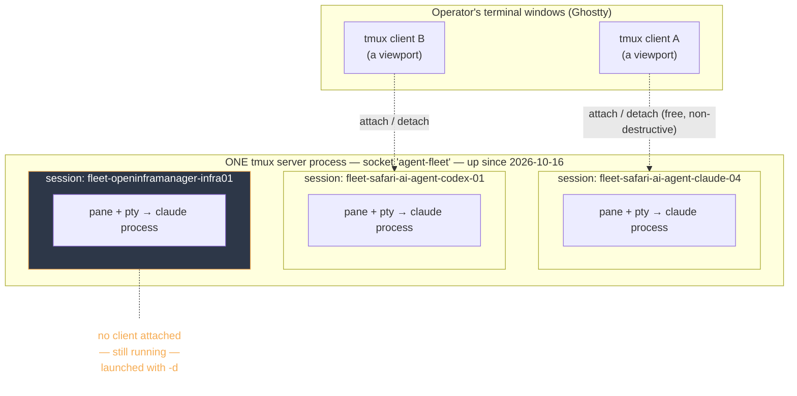
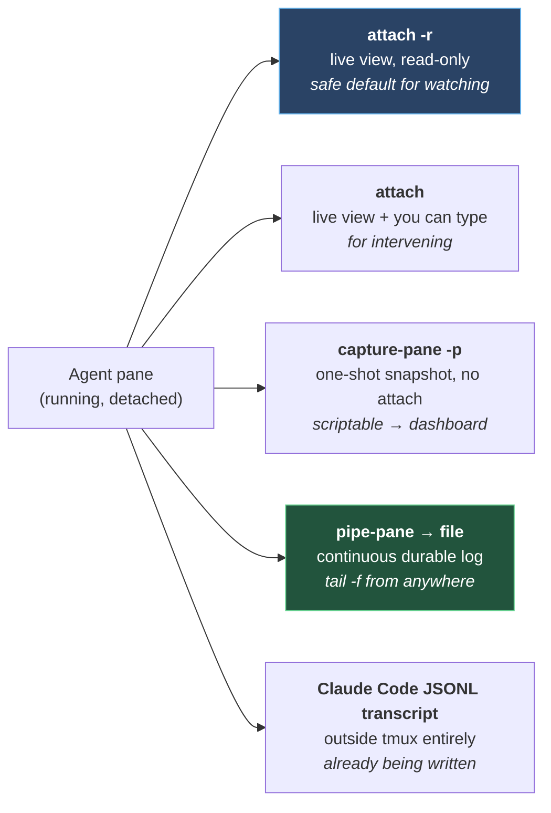
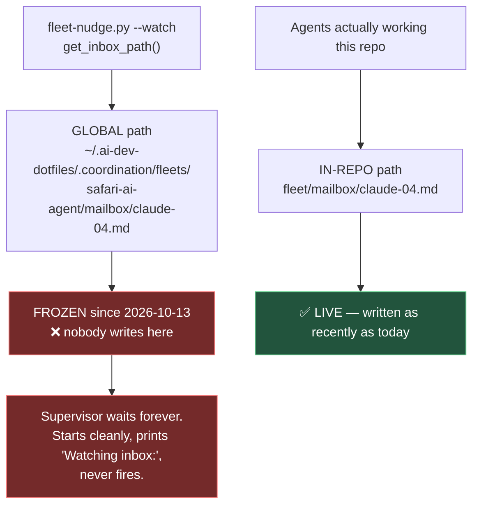
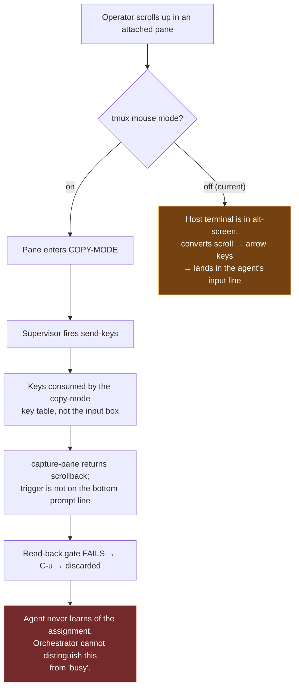
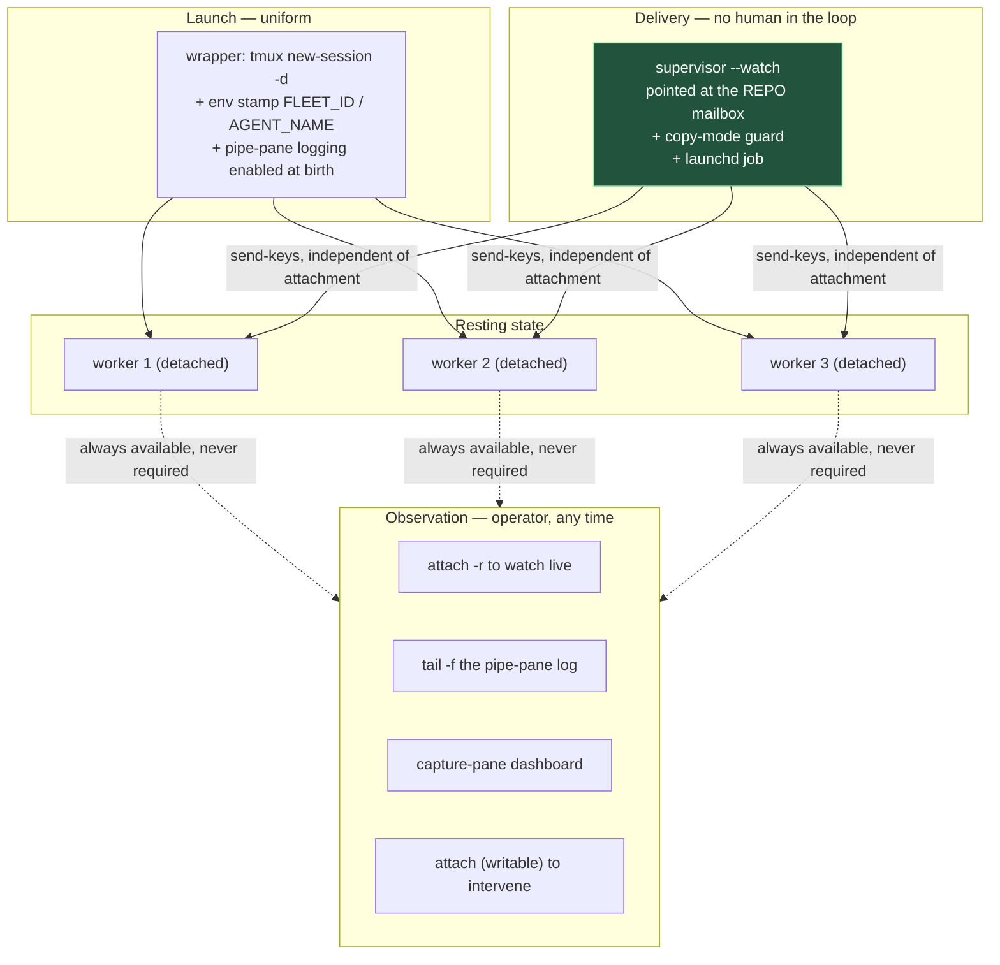

# Fleet tmux Hosting, Nudge Delivery and Operator Observability — Analysis

**File:** `docs/FLEET-TMUX-OBSERVABILITY-ANALYSIS.md`
**Description:** Analysis of how fleet agent sessions are hosted in tmux, how cross-harness nudges are delivered, what the operator can and cannot see, and the defects found in that chain on 2026-10-25. Written for review, not yet acted on. Includes a plain-English primer so the reasoning is accessible without prior tmux knowledge.
**Author:** Libor Ballaty <liborballaty@gmail.com>, with Claude Opus 5 (seat `safari-ai-agent-codex-01` — see the identity note below)
**Created:** 2026-10-25
**Last Updated:** 2026-10-25
**Last Updated By:** `safari-ai-agent-codex-01`

> **This repository is public.** Per `fleet/README.md`, this document deliberately omits process
> IDs, tty device names, usernames and absolute paths containing the operator's home directory.
> Mechanisms are described; live operational state is not.

> **⚠ AUTHORSHIP CORRECTION (2026-10-25).** The first draft of this file was authored as
> `safari-ai-agent-claude-04`, with a lead lane string. **That was wrong.** This session's
> stamped identity — launch `--name`, `AGENT_NAME`, `QUEUECTL_AGENT` — is
> `safari-ai-agent-codex-01`. The author had read `claude-04`'s inbox and assumed that seat.
> No lead authority is claimed or held here: the lead seat is `claude-11`, operator-granted
> 2026-10-25. The first reservation taken for this file was also raised under the wrong seat
> name; it was released and re-taken as `codex-01`. The misidentification is itself an instance
> of finding **F-8**, and is recorded independently by `claude-11` in
> `fleet/fleet-registry.yaml` (`channel_finding_2026_10_25`, `findings_for_the_operator_2026_10_25`).

---

## 1. Why this document exists

It started as a trivial question — *"why is my trackpad suddenly scrolling the command line
instead of the screen?"* — and the answer turned out to sit on top of the fleet's entire
communication and observability design. The scroll annoyance is a symptom. Underneath it are
four real defects in the nudge chain, one of which would make an automated supervisor **fail
silently** for this repo.

This document records the mechanism, the findings, and the recommended end state. **Nothing
here has been changed yet.** Section 9 is the decision list for the operator.

---

## 2. Plain-English primer

If you already know tmux, skip to §3.

**The problem tmux solves.** A command-line program needs a terminal to run in. Normally that
terminal is a window on your screen — close the window and the program dies. That is fine for
a command that takes two seconds. It is useless for an AI agent you want running for days,
or for one you want another program to be able to type into.

**What tmux actually is.** tmux is a background program (a *server*) that creates fake
terminals. "Fake" is not a criticism — they are real as far as any program is concerned. The
technical name is a **pty** (pseudo-terminal). A program running on a pty cannot tell the
difference between that and a window on your screen.

Three words, and the distinction between them is where most confusion lives:

| Term | Plain English |
|---|---|
| **Session** | One workspace the server holds. Contains your running agent. Exists until explicitly killed. |
| **Pane / pty** | The fake terminal inside the session that the agent is actually plugged into. |
| **Client** | A window **looking at** a session. Optional. Comes and goes freely. |

**The key idea: the client is a monitor, not the computer.**

Picture a desktop PC under a desk, switched on and working. The monitor is a separate thing you
can unplug and plug back in. Unplugging the monitor does not switch off the PC, does not pause
it, and does not lose any work. It just means nobody is looking right now.

- **Attached** = monitor plugged in. You can see it. You can type at it.
- **Detached** = monitor unplugged. It is still running, at full speed, doing exactly what it
  was doing.

A session started with the `-d` flag was simply *born* with no monitor attached. That is the
only difference. It is not a lesser or background-only kind of session, and you can plug a
monitor into it at any moment.

**Why this matters for the fleet:** because tmux gives every agent a stable address, another
program can "type" into an agent's terminal from outside. That is how one agent tells another
agent that new work has arrived — and it works no matter which AI tool is running in that pane,
which is the whole reason the design uses tmux.

---

## 3. How agent sessions are hosted today



**What the evidence showed.** The three sessions were launched in two different ways:

| Session | Launch flag | Resting state |
|---|---|---|
| `fleet-openinframanager-infra01` (2026-10-16) | `new-session -d` | detached, deliberately |
| `fleet-safari-ai-agent-codex-01` (2026-10-25) | `new-session` (no `-d`) | attached |
| `fleet-safari-ai-agent-claude-04` (2026-10-25) | `new-session` (no `-d`) | attached |

**Finding worth stating plainly:** the detached `infra01` session is not an orphan or a bug. It
has a pty, it is alive, and it has consumed ~33 minutes of CPU across nine days — real work,
followed by sitting idle at a prompt. It is the *correct* shape for a fleet worker. Today's two
sessions, launched attached, are the inconsistent ones.

**Single point of failure:** all three sessions live in **one** tmux server process, started by
whichever `new-session` ran first (2026-10-16, by the openinframanager launch). Killing that
server kills all three agents simultaneously, including sessions belonging to a different repo
and a different fleet.

---

## 4. How a nudge is delivered (the cross-harness channel)

### 4.1 Plain English

The mailbox is a **file**. Any agent can write to it; any agent can read it. The file is the
permanent record and the actual channel.

But a file changing does not wake anybody up. An agent sitting idle at its prompt has no idea a
file on disk just changed. Something has to go and *tell* it. That "go and tell it" step is the
**nudge**, and it is done by literally typing a sentence into the other agent's terminal, as if
a human had typed it — which is exactly why it works across different AI tools. Typing
characters into a terminal does not care whether Claude, Codex or Gemini is reading them.

The risky part is obvious: a program that types into terminals could type into the *wrong*
terminal. The tooling guards against this in two ways — it verifies the target is really a
fleet agent before typing, and after typing it **reads the screen back** to confirm the text
actually landed in the input box before pressing Enter.

### 4.2 The flow

```mermaid
sequenceDiagram
    autonumber
    participant A as Agent A<br/>(any harness)
    participant M as Mailbox FILE<br/>fleet/mailbox/B.md
    participant S as Supervisor<br/>fleet-nudge.py --watch
    participant T as tmux server
    participant B as Agent B's pane

    A->>M: write assignment<br/>(new ASSIGNMENT-ID)
    Note over M: The file is the RECORD.<br/>The nudge is only a doorbell.

    loop every 1s
        S->>M: poll mtime + ASSIGNMENT-ID
    end
    M-->>S: changed

    S->>T: has-session?
    T-->>S: yes
    S->>T: show-environment (FLEET_ID / AGENT_NAME)
    T-->>S: fleet stamp present
    Note over S,T: Fails CLOSED. A matching session NAME<br/>is not proof; only the launcher's<br/>env stamp is.

    S->>T: send-keys -l "<trigger sentence>"
    S->>T: capture-pane -p
    T-->>S: current screen contents

    alt trigger visible on bottom prompt line
        S->>T: send-keys Enter
        T->>B: agent wakes
        B->>M: reads inbox, acts on assignment
    else trigger NOT visible
        S->>T: send-keys C-u  (wipe the half-typed line)
        S-->>S: log "Read-back gate failed"
        Note over B: Agent never learns.<br/>Silence is ambiguous.
    end
```

**This design is sound.** The read-back gate and the env-stamp check are deliberate, and both
fail closed. The defects below are not flaws in this logic — they are gaps around it.

### 4.3 ⚠ Correction: tmux is not, by itself, a communication channel

An earlier draft of this document presented the above as *the* cross-harness channel and framed
deploying the supervisor as simply filling a gap. **That overstated what is sanctioned.**
`~/.ai-dev-dotfiles/docs/FLEET-TMUX-LAUNCH.md` governs this, and it is explicit:

- **`:7`** — tmux "keeps an agent in a named terminal that a human can attach to **and a
  supervisor can address**. It does not decide when to send messages, recognize permission
  prompts or acknowledge assignments. Those are separately tested supervisor/adapter
  responsibilities."
- **`:61`** — "Use **`nudgeable: false`** until an actual adapter probe succeeds."
- **`:71`** — the probe must cover idle/busy handling, wrong/dead pane, stale capture, modal
  prompts, **input editing mode**, restart/replay, duplicate assignment, withheld
  acknowledgment, approval parking and **operator attach/detach** — fake panes first, "real
  adapters require controlled runtime proof before enabling a real worker."
- **`:68`** — never auto-answer an approval, trust, authentication or destructive-action prompt.
  This matters because a Claude Code TUI *does* show permission prompts.
- **`:75`** — the smoke test that has been run "does not qualify TUI messaging or any other
  harness."

So the accurate statement is: **tmux is the sanctioned place a supervisor may address, but TUI
messaging is unqualified in this fleet and must stay `nudgeable: false` until a probe passes.**
`fleet-nudge.py` is a candidate adapter, not an approved one. F-3 (copy-mode) is not an
alternative to that probe — it is one of the `:71` cases ("input editing mode", "operator
attach/detach") failing in advance, i.e. evidence the probe is necessary.

**Empirically confirmed during this session:** a message arrived from peer `claude-11` through
the Claude Code harness session registry — **not** through tmux. Claude↔Claude messaging works
and is independent of tmux entirely. The 2026-10-13 finding that a genuine Claude↔Codex pair has
no direct channel still stands unamended; the apparent counter-example is the `codex-01` seat
being Claude Code (F-8), i.e. the same harness wearing the wrong name.

Credit: this correction is `claude-11`'s, recorded in `fleet/fleet-registry.yaml`
(`channel_finding_2026_10_25`) and verified independently against the source lines above.

**→ For which agent pairs can actually talk, and what adding a Codex or Antigravity agent
costs, see the companion document `docs/FLEET-CROSS-HARNESS-COMMUNICATION.md`.** It carries the
channel matrix and the per-harness probe cost model; this document stays focused on tmux
hosting, delivery mechanics and operator observability.

---

## 5. What the operator can see

A detached session is **not** invisible. Attachment is one of five independent ways to observe,
and the weakest one for history.



**The correction that matters most in this whole document:**

> Nudge delivery is **completely independent of attachment**. `send-keys` targets a session by
> name and works identically whether zero or three clients are watching. tmux also allows
> multiple clients attached to one session at the same time.

There is therefore **no trade-off** between "I can see what the agent is doing" and "the agent
gets nudged automatically." Both, always. An earlier framing in conversation — that an attached
operator *is* the nudge channel — was wrong and is corrected here so it does not propagate.

### 5.1 Attaching, step by step

To **watch** a running agent:

1. Open a new terminal window or tab.
2. Run:
   ```bash
   tmux -L agent-fleet attach -r -t fleet-openinframanager-infra01
   ```
3. The window is now a live view. Output appears as it happens.
4. To leave: press **Ctrl+b**, release both keys, then press **d**.
5. You are back at your shell. The agent never paused and never noticed either event.

`-r` is read-only — you see everything, but your keystrokes cannot reach the agent. That is the
right default for looking at a working agent.

To **intervene**: the same command without `-r`, then type normally, then `Ctrl+b` `d`.

**Four things that will bite you otherwise:**

- **`Ctrl+b` is tmux's own key.** Inside an attached session it means "the next keystroke is for
  tmux, not the agent." Everything else passes through to the agent.
- **Never leave with `exit` or `Ctrl+d`.** That closes the agent's shell and kills it. Always
  `Ctrl+b` `d`.
- **Closing the terminal window is safe.** It detaches; it does not kill.
- **Your window size changes theirs.** The server is set to `window-size latest`, so attaching
  resizes the session to *your* window and the agent's display reflows. Harmless, but a small
  window visibly scrambles their layout until it redraws. Keep observation windows a normal size.

---

## 6. Findings

Local IDs `F-1`…`F-8`. These are **not** `D-###` decision records; promoting any of them to
`docs/DECISIONS.md` or `docs/TRACKER.md` is a follow-up, not something this document does.

| ID | Finding | Severity | Status |
|---|---|---|---|
| F-1 | Nudge supervisor exists in code but is not running, has no launchd job — **and is not yet qualified to run** (§4.3) | Medium | open |
| F-2 | Supervisor resolves the **wrong mailbox path** for this repo — would fail silently | **Critical** | open |
| F-3 | Scrolling can put a pane in copy-mode, which defeats nudge delivery | Medium | open |
| F-4 | Attached sessions have no usable scrollback (the original scroll symptom) | Low | open |
| F-5 | Launch mode is inconsistent — some sessions `-d`, some attached | Low | open |
| F-6 | One tmux server is a shared single point of failure across two fleets | Medium | open |
| F-7 | `history-limit` is the stock 2000 lines | Low | open |
| F-8 | The `codex-01` seat runs Claude Code, not Codex CLI — a misnomer that caused a real misidentification | **High** | open — operator decision |

### F-1 — The supervisor is written but not deployed

`fleet-nudge.py` **already is** the supervisor: `--watch` polls an inbox's mtime and
`ASSIGNMENT-ID` and calls the delivery path. A setup document exists. But:

- no such process is running on this machine;
- there is **no launchd job**, so nothing starts it at login;
- it is **one daemon per agent** (`--fleet X --agent Y`), not one per fleet. Three workers means
  three daemons to supervise.

Consequence: every nudge today requires a human to notice and relay it. That is precisely the
manual step the design exists to remove.

### F-2 — The supervisor would watch a file nobody writes *(the critical one)*

`get_inbox_path()` resolves to the **global** coordination root:
`~/.ai-dev-dotfiles/.coordination/fleets/<fleet>/mailbox/<agent>.md`.

This repo **moved its mailbox into the repository** on 2026-10-13 (operator decision, recorded
in the redirect stub at the old location). The global copy is explicitly frozen.



**Why this is the worst kind of defect:** it looks healthy. The daemon starts, prints a
reassuring "Watching inbox:" line, and then does nothing forever. The tool's own source comment
warns about exactly this class of failure — *"a nudge delivered against the wrong root silently
watches an inbox nobody writes."* Moving the mailbox created the condition the author
anticipated.

**A supervisor pointed at a dead file is worse than no supervisor**, because it converts a known
gap into a false assurance.

### F-3 — Copy-mode defeats delivery



Verified on a throwaway tmux socket: `#{pane_in_mode}` reliably reports copy-mode state, and
`send-keys -X cancel` exits it. **Caveat found in the same test:** a bare `cancel` when the pane
is *not* in a mode errors (`not in a mode`, exit 1), so the fix must be guarded, not
unconditional:

```bash
tmux -L agent-fleet if -F '#{pane_in_mode}' 'send -X cancel' -t <session>
```

Roughly three lines in `fleet-nudge.py`, immediately before the `send-keys -l` call. This
removes the hazard permanently rather than asking the operator to remember not to scroll.

Note the hazard is **not** unique to mouse mode — `Ctrl+b [` enters the same copy-mode. The
difference is that mouse mode lets you enter it *by accident*, with a gesture nobody thinks of
as a mode change.

### F-4 — No usable scrollback while attached (the original symptom)

Two stock settings combine badly:

- `alternate-screen on` — tmux occupies the host terminal's alternate screen, so the terminal's
  own scrollback is unavailable while tmux runs. **Inside tmux, copy-mode is the only scrollback
  that exists.**
- `mouse off` — tmux is not capturing scroll either, so it offers nothing in exchange.

The scroll event therefore falls through to the host terminal while it is in alternate-screen
mode, where (on the common macOS terminals) it is translated into Up/Down arrow keys — which
land in the agent's input line. Hence "the trackpad scrolls the command line."

There is no configuration that restores *native* terminal scrollback inside tmux; the host
terminal is in alt-screen for as long as tmux runs. The options are to make copy-mode pleasant,
or to not be attached.

`mouse on` plus Shift-arrow bindings is the practical fix. Plain arrow keys **cannot** be used —
the agent needs them for input editing and prompt history:

```
set -g mouse on
set -g history-limit 50000
bind -n S-Up    if -F '#{pane_in_mode}' 'send -X scroll-up'   'copy-mode'
bind -n S-Down  if -F '#{pane_in_mode}' 'send -X scroll-down' ''
```

**This is only safe once F-3 is fixed.** Enabling mouse mode first would make accidental
unreachability easier, not harder.

*Terminal-specific note:* iTerm2's `tmux -CC` control mode renders tmux sessions as native tabs
with native scrollback, which would make this finding vanish entirely. The operator's terminal
is Ghostty, which does not implement control mode, so that route is closed without changing
terminals.

### F-5 — Inconsistent launch mode

Two sessions launched attached, one detached. Under the recommended model (§7) every worker is
born detached and the operator attaches to look. Today, closing a window for the two attached
sessions is a disruptive act rather than a routine one.

### F-6 — Shared tmux server across fleets

One server process holds `safari-ai-agent` and `openinframanager` sessions together. A restart,
a crash, or a `kill-server` takes out both fleets. Separate sockets per fleet would isolate the
blast radius, at the cost of one more socket name to remember.

### F-7 — `history-limit` 2000

Thin for an agent session, and it silently caps how far back you can scroll even after F-4 is
fixed. Applies to panes created *after* the change, so it is not retroactive.

### F-8 — The `codex-01` seat is Claude Code *(confirmed, and it bit this document)*

No longer an inference. The seat named `codex-01`, which `fleet/fleet-registry.yaml` records as
`harness: codex-cli`, runs `claude --model opus`. Confirmed independently twice on 2026-10-25 —
by `claude-11` (registry, `channel_finding_2026_10_25`) and by this session inspecting its own
pane.

**This is not cosmetic. It produced two concrete failures the same morning:**

1. **This document's author got it wrong.** This session read `claude-04`'s inbox, assumed that
   seat, asserted lead authority it does not hold, and raised a queuectl reservation under
   another agent's name — all from trusting a seat name over the stamped identity. Corrected in
   the banner at the top.
2. **A peer nearly recorded a false protocol finding.** `claude-11` observed that `codex-01` was
   discoverable and messageable, which appears to contradict the 2026-10-13 "no cross-harness
   channel" finding. It checked the pane instead of trusting the name and caught it. Had it not,
   the registry would now claim Claude↔Codex messaging works — *the right conclusion from the
   wrong evidence*, and very hard to unwind later.

A second defect sits in the same launch profile: that session was started with `--add-dir` and a
matching `Edit(...)` permission pointing at the **frozen external mailbox** superseded on
2026-10-13 — the same stale root as F-2, arriving by a different route.

**Reserved to the operator.** A rename is an identity event touching git history, mailbox
filenames and file headers, and the launch profile is operator-owned. No agent should
self-resolve it. Until it is resolved, **verify a seat's harness by inspecting its pane, never
by reading its name.**

---

## 7. Recommended end state



Principles:

1. **Detached is the resting state.** Uniform across all workers.
2. **The supervisor nudges, not the operator.** The human is an observer by choice, never a
   courier by necessity.
3. **Transparency does not depend on presence.** `pipe-pane` logging from launch means a worker
   you were not watching is still reviewable afterwards. Attaching shows only the present, and
   the present is capped at `history-limit` lines.
4. **Observation is read-only by default.** Intervening is a deliberate second step.

---

## 8. Recommended order of work

| # | Action | Why this order |
|---|---|---|
| 1 | **F-2** — make the supervisor resolve the in-repo mailbox | A supervisor on a dead path is worse than none. Everything else is pointless until the path is right. |
| 2 | **F-3** — copy-mode guard in `fleet-nudge.py` | Makes "watch a live worker" safe. Prerequisite for F-4. |
| 3 | **Adapter qualification probe** per `FLEET-TMUX-LAUNCH.md:71` — fake panes first | **Mandatory gate.** `nudgeable: false` until it passes. Not optional, not skippable. |
| 4 | **F-1** — deploy the supervisor (launchd) | Permitted *only* after step 3 passes. |
| 5 | **pipe-pane logging** at launch | Biggest observability gain per unit of effort; **independent of steps 1–4** and safe to do first. |
| 6 | **F-4 / F-7** — `mouse on`, Shift-arrows, `history-limit` | Comfort. Safe only after step 2. |
| 7 | **F-5 / F-6 / F-8** — launch uniformity, socket split, naming | Hygiene. F-8 is an operator identity decision, not an agent's to make. |

**Step 5 is the one to do first if only one thing gets done.** It is pure observability, touches
no delivery path, needs no probe, and is the only item that improves transparency whether or not
automated nudging is ever enabled.

Steps 1–3 touch `~/.ai-dev-dotfiles/tools/fleet-nudge.py`, which is **outside this repo** and
shared by other fleets. It needs its own reservation and should not be changed casually from a
session whose declared scope is this repo.

---

## 9. Open questions for the operator

1. **Where should the mailbox path fix live?** Options: teach `fleet-nudge.py` to resolve a
   repo-local mailbox when one exists (helps every repo that follows this one); add a
   `--inbox-path` override (smallest change, pushes the knowledge to the caller); or revert this
   repo to the global mailbox (contradicts the 2026-10-13 decision and its reasoning).
2. **Should the supervisor be per-agent or per-fleet?** The current tool is per-agent. A
   per-fleet watcher is a larger change but one daemon instead of N.
3. **Is `infra01` still wanted?** It has been idle at a prompt for nine days with nothing
   nudging it. Either it is a live worker nobody is feeding, or it should be retired.
4. **Separate tmux sockets per fleet?** (F-6) Isolation versus one more thing to remember.
5. **Should interactive sessions be launched detached too?** Uniformity argues yes; it costs one
   `attach` command at the start of a working session.

---

## 10. What was verified, and how

Distinguishing inspection from inference, per the operating standard:

**Verified by direct observation:**
- Session names, creation dates, attach state, and launch flags (`-d` or not) — from the tmux
  server's own process list and `list-sessions`.
- One shared tmux server parenting all three panes.
- `mouse off`, `alternate-screen on`, `window-size latest`, `history-limit 2000`.
- `#{pane_in_mode}` reporting and `send-keys -X cancel` behaviour, including the "not in a mode"
  error — tested on a throwaway socket created and destroyed for the purpose.
- `fleet-nudge.py` having `--watch`, its delivery sequence, the read-back gate, the env-stamp
  check, and `get_inbox_path()` resolving to the global root.
- No supervisor process running; no launchd job for one.
- The in-repo mailbox being actively written; the global one carrying a redirect stub.

**Inference, not verified here:**
- That the host terminal converts scroll to arrow keys in alternate-screen mode. The symptom
  matches that behaviour precisely, but tmux overwrites the environment variable that would
  identify the host terminal's own setting, so this was not read directly.
- That `fleet-safari-ai-agent-codex-01` is misnamed (F-8) rather than running a wrapper that
  execs `claude`. Only the pane's foreground command was observed.

**Noted, not investigated:** this agent's own `claude-04.status.md` in the repo mailbox was
modified during this session by something other than this session. Either a peer wrote into a
file outside its scope, or an automated process did. Worth establishing before the mailbox is
relied on as the coordination record.
