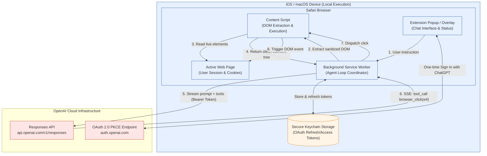

# Architecture: ChatGPT Path C Safari Agent

**File:** `poc-chatgpt/docs/ARCHITECTURE.md`
**Status:** Living architecture document
**Target Environment:** iOS Safari & macOS Safari (Manifest V3 Web Extension)
**Model Backend:** OpenAI Responses API (`/v1/responses`) via Sign in with ChatGPT

---

## 1. System Overview

The **ChatGPT Path C Safari Agent** is a single-device, on-browser automation agent. It eliminates external relays, server infrastructure, and split-screen workflows by running entirely within the user's browser session.

---

## 2. Key Architecture Differences: Claude Relay vs. ChatGPT Path C

| Dimension | Previous Architecture (Claude Relay) | New Architecture (ChatGPT Path C) |
| :--- | :--- | :--- |
| **Execution Topology** | Inverted Relay: Mac required as public HTTPS gateway | **Zero-Relay:** 100% on-device inside Safari |
| **Network Hops** | iPad Safari ↔ Tailnet ↔ Mac ↔ Anthropic | **Direct:** Device ↔ OpenAI |
| **User Surface** | Multi-app: Claude app + Safari (Split View) | **Unified:** Embedded inside Safari toolbar/popup |
| **Subscription Mechanism**| Unofficial reverse MCP polling | **Official:** OAuth token sharing (`chatgpt.tokens.use.direct`) |
| **API Endpoints** | Claude MCP over Streamable HTTP | OpenAI Responses API (`/v1/responses`) via SSE |
| **Offline/Sleep Dependency**| Mac must remain awake and online | No secondary machine needed |

---

## 3. Data Flow & Security Boundaries

### A. Authentication & Credential Storage
1. **OIDC + PKCE Flow:** The user initiates "Sign in with ChatGPT". An ephemeral `code_verifier` (SHA-256) protects against interception.
2. **Scopes:** `openid profile email resource.invoke chatgpt.tokens.use.direct` targeted at `resource=https://api.openai.com/v1`.
3. **Storage:** Tokens are persisted in the native iOS Keychain (accessible to extension and host app via App Group). Tokens never pass through any third-party server.

### B. DOM Inspection & Sanitization Boundary
Before any page content is sent to the model:
1. **Non-interactive filtering:** Raw SVG paths, styling tags, metadata, and scripts are stripped.
2. **Field Value Exclusions:** Password inputs, payment/credit card inputs, hidden fields, and one-time codes are **never** read or sent.
3. **Monotonic IDs:** Interactive nodes receive deterministic IDs (`e1`, `e2`, ...) mapped in content script memory.

### C. Execution & Approval Boundary
1. **Read actions (`browser_inspect`):** Executed automatically.
2. **Navigation (`browser_navigate`):** Constrained to the same origin; cross-domain jumps are flagged for human approval.
3. **Write actions (`browser_fill`, `browser_click`):** Dispatched via synthetic `MouseEvent` and `InputEvent` directly into the page context.
