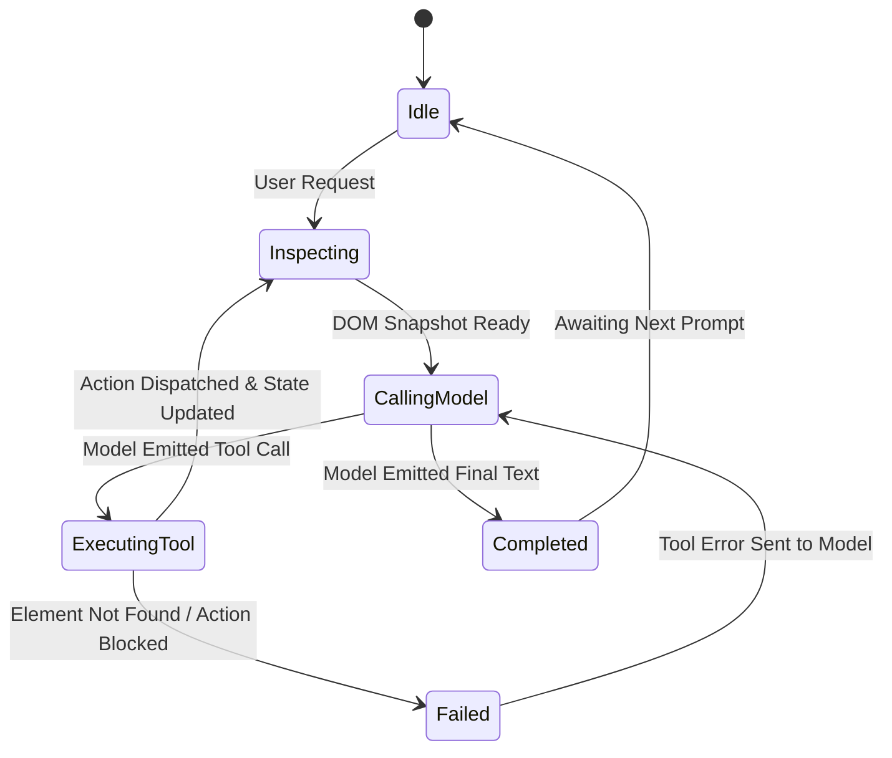

# Technical Design: ChatGPT Path C Safari Agent

**File:** `poc-chatgpt/docs/DESIGN.md`
**Status:** Living design document
**Scope:** Protocol specifications, tool schemas, DOM engine contracts, and state machine.

---

## 1. Authentication Protocol: Sign in with ChatGPT (PKCE)

### Endpoints
* **Authorization:** `https://auth.openai.com/oauth/authorize`
* **Token Exchange:** `https://auth.openai.com/oauth/token`
* **Audience / Resource:** `https://api.openai.com/v1`

### Parameters
```text
client_id:     <REGISTERED_OR_DYNAMIC_CLIENT_ID>
response_type: code
redirect_uri:  safari-agent://oauth/callback (or http://127.0.0.1:8787/callback for CLI)
scope:         openid profile email resource.invoke chatgpt.tokens.use.direct
resource:      https://api.openai.com/v1
code_challenge: Base64URL(SHA256(code_verifier))
code_challenge_method: S256
```

### Token Exchange Request
```http
POST /oauth/token HTTP/1.1
Host: auth.openai.com
Content-Type: application/x-www-form-urlencoded

grant_type=authorization_code
&client_id=<CLIENT_ID>
&code=<CODE>
&redirect_uri=<REDIRECT_URI>
&code_verifier=<VERIFIER>
```

---

## 2. OpenAI Responses API Contract (`/v1/responses`)

### Tool Declarations
The agent advertises four discrete DOM tools in the `tools` array:

```json
[
  {
    "type": "function",
    "function": {
      "name": "browser_inspect",
      "description": "Inspect interactive elements and structure of the active page.",
      "parameters": {
        "type": "object",
        "properties": {},
        "additionalProperties": false
      }
    }
  },
  {
    "type": "function",
    "function": {
      "name": "browser_click",
      "description": "Click an interactive element identified by its ref ID.",
      "parameters": {
        "type": "object",
        "properties": {
          "ref": {"type": "string", "description": "Element reference ID (e.g., 'e12')"}
        },
        "required": ["ref"],
        "additionalProperties": false
      }
    }
  },
  {
    "type": "function",
    "function": {
      "name": "browser_fill",
      "description": "Type text into an input field or textarea identified by its ref ID.",
      "parameters": {
        "type": "object",
        "properties": {
          "ref": {"type": "string", "description": "Element reference ID"},
          "value": {"type": "string", "description": "Text value to insert"}
        },
        "required": ["ref", "value"],
        "additionalProperties": false
      }
    }
  },
  {
    "type": "function",
    "function": {
      "name": "browser_navigate",
      "description": "Navigate to a relative path or same-origin URL on the current website.",
      "parameters": {
        "type": "object",
        "properties": {
          "url": {"type": "string", "description": "Target same-origin URL"}
        },
        "required": ["url"],
        "additionalProperties": false
      }
    }
  }
]
```

### Streaming Event Loop (Server-Sent Events)
The agent consumes the streaming chunks:
* `response.output_item.added`: Captures new function call initiation.
* `response.function_call_arguments.delta`: Accumulates arguments JSON.
* `response.output_item.done`: Signals completion of tool call arguments.
* `response.completed`: Terminal event indicating turn conclusion.

---

## 3. DOM Engine: Inspection & Serialization

### Element ID Assignment
Interactive elements (`a`, `button`, `input`, `select`, `textarea`, `[role=button]`, `[onclick]`) receive a temporary attribute:
```html
<button data-agent-id="e1" class="btn-primary">Search</button>
```

### Serialized Representation
The DOM is converted to a compact, markdown-like outline:
```text
URL: https://example.com/checkout
Title: Checkout - Order Review
Elements:
[e1] input (text, name="fullName", placeholder="Full Name")
[e2] input (email, name="email", placeholder="Email address")
[e3] select (name="shippingSpeed", options=["Standard", "Express"])
[e4] button "Continue to Payment"
[e5] a "Back to Cart"
```

---

## 4. Multi-Turn State Machine



---

## 5. Error Taxonomy

* `subscription_sharing_usage_limit_exceeded`: User hit their ChatGPT Plus/Pro weekly/hourly cap. Display a clean UI warning.
* `unauthorized_token_expired`: Access token expired. Trigger automatic refresh using the Keychain-stored `refresh_token`.
* `element_not_found`: Referenced `ref` (e.g., `e14`) is no longer in DOM. Trigger automatic `browser_inspect` to re-synchronize element tree.
* `cross_origin_blocked`: Navigation requested a different origin. Refuse automatically to prevent domain hijacking.
